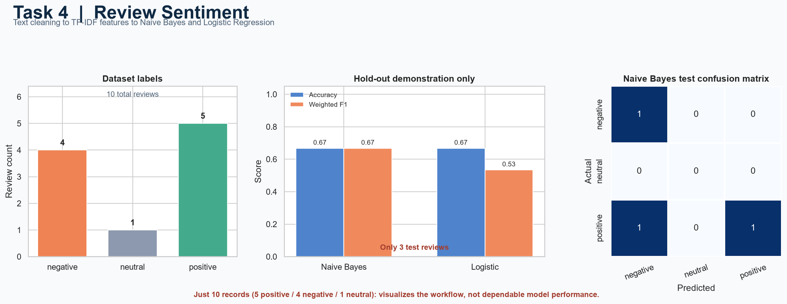

# NLP Sentiment Classification on Customer Reviews

An end-to-end text classification project that cleans customer reviews, converts text to TF-IDF features, and compares Multinomial Naive Bayes with Logistic Regression.

## Project Preview



> **Dataset limitation:** The supplied data has only 10 reviews (5 positive, 4 negative, and 1 neutral). The neutral example is retained in training, but this dataset is too small to support meaningful benchmarks or reliable generalization claims. Treat the notebook metrics as a demonstration only.

## Project structure

```text
NLP-Sentiment-Classification-on-Customer-Reviews/
├── data/
│   ├── README.md
│   └── sentiment_reviews.csv
├── notebooks/
│   └── sentiment_classification.ipynb
├── src/
│   └── sentiment_classifier.py
├── screenshots/
│   └── 01_project_preview.png
├── requirements.txt
└── README.md
```

## Dataset

The CSV contains `review_id`, `review_text`, and `sentiment`. Labels are `positive`, `negative`, and `neutral`. The notebook preserves the neutral record and treats the task as three-class classification. See [`data/README.md`](data/README.md) for dataset details.

## Workflow

1. Validate and inspect the review data.
2. Remove HTML and punctuation, lowercase and tokenize text, remove English stopwords, and lemmatize tokens with NLTK.
3. Use a reproducible hold-out split. Labels represented by a single example are kept in training; those labels cannot be independently evaluated.
4. Fit `TfidfVectorizer(max_features=5000)` on training data and compare Multinomial Naive Bayes and Logistic Regression.
5. Report accuracy, weighted and macro precision/recall/F1, classification reports, and confusion matrices.
6. Try custom reviews with the reusable `predict_sentiment()` helper in `src/sentiment_classifier.py`.

The vectorizer is trained only on the training reviews to prevent vocabulary leakage. The test set is extremely small, so its scores are not dependable estimates of model performance.

## Setup

Run these commands from the project root:

```bash
python -m pip install -r requirements.txt
jupyter notebook notebooks/sentiment_classification.ipynb
```

Run notebook cells from top to bottom. NLTK stopword and WordNet data are downloaded by the source module if they are missing; first-time setup requires internet access.

For a quick prediction from the project root:

```python
import sys
from pathlib import Path

sys.path.insert(0, str(Path("src").resolve()))
from sentiment_classifier import build_models, load_reviews, predict_sentiment, split_reviews

reviews = load_reviews("data/sentiment_reviews.csv")
X_train, _, y_train, _, _, _ = split_reviews(reviews)
model = build_models()["Multinomial Naive Bayes"].fit(X_train, y_train)
predict_sentiment("The setup was easy and the product works perfectly.", model)
```

The prediction helper returns a sentiment and per-class probabilities. Because the training sample is tiny, predictions are illustrative and should not be used for real customer decisions.

## Limitations and next steps

- Ten examples cannot teach broad language patterns or support stable evaluation.
- The single neutral review is necessarily kept in training and has no independent test evaluation.
- Gather a larger, representative, consistently labeled dataset with sufficient examples in every class before drawing conclusions.
- With more data, use a fixed representative test set or stratified cross-validation and inspect class-specific metrics before deployment.
